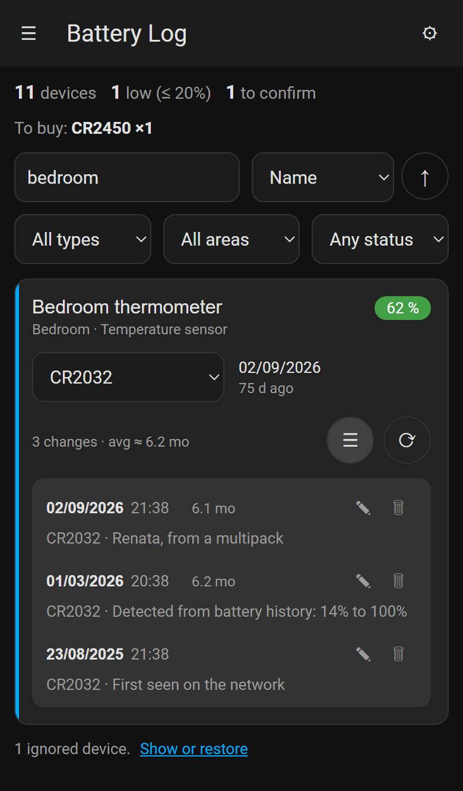
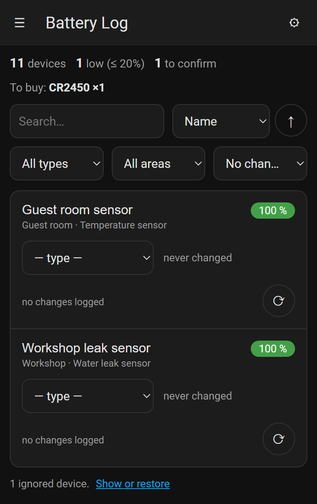
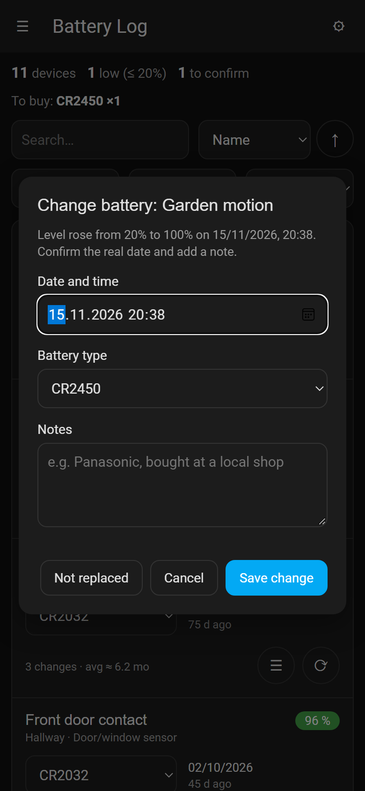
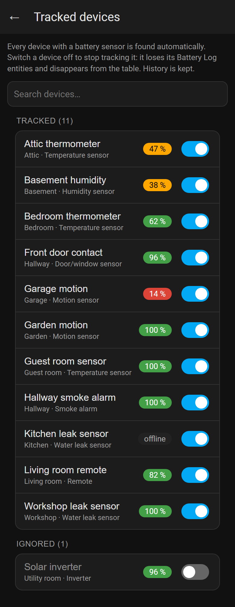
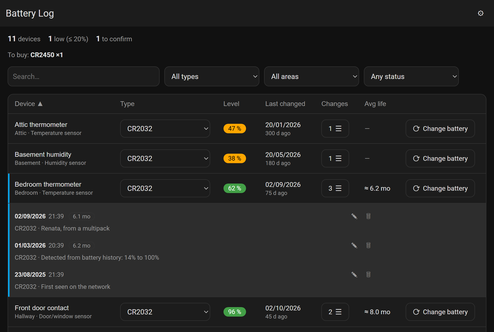

# Battery Log for Home Assistant

[Українська версія](README.uk.md)

A small, local-only Home Assistant integration that answers three questions
about every battery-powered device in your home:

- **What battery does it take?** A type you pick from a short list you control.
- **When did I last change it, and all the times before?** A full history with
  date and notes (brand, where you bought it, ...).
- **Which ones need attention?** One table with filters, sorting and a
  "what to buy" summary.

No cloud, no external database, no per-device setup. It finds your battery
devices by itself.

[](https://my.home-assistant.io/redirect/hacs_repository/?owner=alexd-3d&repository=ha-battery-log&category=integration)

<p>
  
  
  
</p>

<p>
  
  
</p>



<sub>Screenshots use invented demo devices and are in English. The panel and the
integration are also available in Ukrainian and follow your Home Assistant
language. From left to right: sorting by level, history with intervals, newly
found devices (no type and no entries yet), confirming a possible replacement,
the tracked and ignored devices screen.</sub>

## Features

- **Automatic discovery.** Every device that has a battery sensor
  (`device_class: battery`, a `sensor` or a `binary_sensor`) is picked up from the
  Home Assistant registries. New devices appear on their own, nothing to add
  or ignore one by one.
- **Three entities per device**, on the device's own page: `select` battery
  type, `button` "Battery changed", `sensor` "Battery last changed".
- **Full replacement history.** Every change keeps its date, type and a free
  text note. Add, edit and delete entries; each row shows how long the
  previous battery lasted.
- **A panel instead of a card.** Sortable and filterable table (type, area,
  status), search, level colours, shopping summary by battery type,
  average battery life. On a phone it turns into a card list with icon buttons.
- **"Replaced?" hint.** When a battery level jumps up (default 25 points), or a
  "battery low" flag clears, the row gets a badge. Tap it to confirm: the date
  is pre-filled with when the jump was seen and you can edit it, add notes, or
  answer "Not replaced". Nothing is logged without your confirmation.
- **Your own battery types.** Nine predefined (CR2032, CR2450, CR123A, CR2, AAA,
  AA, 9V, Built-in rechargeable, Other) plus "Add new type..." from the panel.
- **Tracked devices screen.** Switch off devices that should not be tracked
  (an inverter battery bank, for example). Ignoring asks for confirmation, and
  ignored devices stay in a list from where you can restore them.
- **Import from Battery Notes** (types and last replaced dates) from the integration's
  Configure menu, shown only when Battery Notes is installed.
- **Automation friendly.** Services and events (see below).
- **Local only.** Data lives in `.storage/battery_log`; the integration makes
  no network requests.
- **English and Ukrainian**, for the integration and the panel. Dates and times
  follow your device's format.

## Install

### HACS (recommended)

1. HACS, three dots menu, **Custom repositories**.
2. Repository `https://github.com/alexd-3d/ha-battery-log`, category
   **Integration**, **Add**. (Or use the button at the top of this page.)
3. Find **Battery Log** in HACS, **Download**.
4. Restart Home Assistant.
5. **Settings, Devices & services, Add integration, Battery Log.** There is
   nothing to fill in.

### Manual

Copy the `custom_components/battery_log` folder into your Home Assistant
`config/custom_components/` folder, restart, then add the integration as above.

Requires **Home Assistant 2026.10** or newer. Developed and tested on 2026.10
with Zigbee2MQTT devices. Any integration that exposes a standard battery
sensor should work.

## Using it

- Open **Battery Log** from the sidebar, or from
  **Settings, Devices & services, Battery Log**. The sidebar entry is optional
  (integration options).
- **Change battery** opens a dialog: date and time (now by default), type and
  notes. The same dialog edits old entries.
- The list icon on a row opens its history.
- The "tune" icon in the header opens **Tracked devices**.
- The battery type can also be set from the device page or in automations.

### Options

Settings, Devices & services, Battery Log, **Configure**:

| Option | Default | Meaning |
|---|---|---|
| Show in sidebar | on | The panel stays reachable from the integration page when off. |
| Low level (red) | 20% | At or below: red, counted in "to buy". |
| Warning level (yellow) | 50% | Above low and up to this value: yellow, higher is green. |
| Possible replacement: level rise | 25 | A rise of at least this many points raises the "Replaced?" hint. |

Changing options reloads the integration; refresh an already open panel.

## Entities

For every tracked device:

| Entity | Notes |
|---|---|
| `select` Battery type | Options come from the shared type list. |
| `button` Battery changed | Logs a change right now. Use the panel for notes or another date. |
| `sensor` Battery last changed | Timestamp. Attributes: `changes_count`, `average_lifetime_days`, `battery_type`, `last_note`, `replacement_suspected`, `recent_changes`. |

## Services

| Service | Fields |
|---|---|
| `battery_log.change` | `device_id`, optional `date`, `note`, `battery_type` |
| `battery_log.set_type` | `device_id`, `battery_type` |
| `battery_log.add_type` | `battery_type` |

## Events

- `battery_log_changed`: `device_id`, `device_name`, `changed_at`, `note`,
  `battery_type`, `source` (`button`, `panel` or `service`).
- `battery_log_replacement_suspected`: `device_id`, `device_name`,
  `from_level`, `to_level`.

Example: ask on your phone when a replacement is suspected.

```yaml
automation:
  - alias: "Battery replaced? Confirm in Battery Log"
    triggers:
      - trigger: event
        event_type: battery_log_replacement_suspected
    actions:
      - action: notify.notify
        data:
          message: >-
            {{ trigger.event.data.device_name }}: battery level jumped
            to {{ trigger.event.data.to_level }}%. Confirm the change in Battery Log.
```

## Coming from Battery Notes

If Battery Notes is installed, **Settings, Devices & services, Battery Log,
Configure** offers **Import from Battery Notes** (the entry is not shown when
Battery Notes is not installed). It takes over, once:

- the battery **type** of each device, only where Battery Log has none yet and only
  for types that exist in your list (types that do not exist are listed in the
  result and kept in the note; add them to the list and run it again);
- the **last replaced** date of each device as one history entry with the note
  "Imported from Battery Notes". A battery quantity such as "2x" and the
  Battery Notes note are appended to that note.

Nothing is changed in Battery Notes, running the import again does not add
anything twice, and importing does not fire the `battery_log_changed` event.
Battery Notes keeps only one date per device, and it can be the day you started
tracking rather than a real replacement, so check the dates afterwards. Both
integrations can run side by side.

## How it compares

Short, factual overview of related projects as of November 2026, based on their
public documentation and community posts. Projects change, so please check
their pages for current details, and tell me if something here is out of date.

| | **Battery Log** | [Battery Notes](https://github.com/andrew-codechimp/HA-Battery-Notes) | [Device Sentinel](https://github.com/TheThinkingHome/device_sentinel) | [BatteryBrain](https://github.com/larsbaum/battery_brain) | [Battery Status Manager](https://github.com/OleSint/ha-battery-status-manager) |
|---|---|---|---|---|---|
| Main purpose | Battery type and replacement log | Battery type, last replaced, low and not-reported tracking | Frozen devices, battery and signal health | Learns discharge behaviour per device | Low-battery and fast-drain notifications |
| Finds battery devices on its own | Yes, from the registries | Library match, then you add each device from a discovery card (or manually) | Learns devices automatically | Yes | Monitors all battery entities (scope chosen in setup) |
| Full replacement history | **Yes**, with notes, edit, delete | Last date only | Swap detection with history and archive | Not documented | No |
| Replacement detection | Hint, you confirm (editable date) | Event on level increase; the date is not updated | Detects a swap and asks you to confirm | Not documented | No |
| Interval between replacements | Yes, per entry and average | No | Remaining-life estimates | Not documented | No |
| Own table with filters | Yes (panel) | No (integration page and your dashboards) | Yes (sidebar dashboard) | No (four summary sensors) | No |
| Battery type | Your own list | Community library plus manual entry | Not documented | Not documented | No |
| Notifications | No (events for your automations) | No (events, triggers, actions) | Yes | Not documented | Yes |
| Predictions | No | No | Yes | Adaptive thresholds | Depletion forecast for numeric sensors |
| External data | None | Downloads a device library | Not documented | Not documented | Not documented |
| Entities added per device | 3 | 4 to 5 | Not documented | None per device (summary sensors) | None |

Which one to pick:

- Battery Log keeps a **record**: what battery, when it was replaced, notes,
  how long it lasted. It deliberately does not send notifications or predict
  anything.
- Use **Battery Notes** if you want its device library and low/not-reported
  triggers; it can replace per-device threshold logic.
- Use **Device Sentinel** or **BatteryBrain** if you want learned health and
  predictions; **Battery Status Manager** if you mostly want notifications.
- They combine well: let another tool warn you, and write the replacement into
  Battery Log.

## Good to know

- The panel requires an administrator account.
- Battery levels from some devices jump around (Zigbee sensors that report in
  coarse steps). Those can produce "Replaced?" hints that you can dismiss with
  **Not replaced**.
- A device without any battery sensor in Home Assistant is not discovered.
- Removing the integration leaves `.storage/battery_log` in place so your
  history survives a reinstall. Delete the file if you want it gone.

## Development

```bash
python -m pytest tests
node --check custom_components/battery_log/frontend/battery-log-panel.js
```

Issues and pull requests are welcome. Licensed under the [MIT License](LICENSE).
