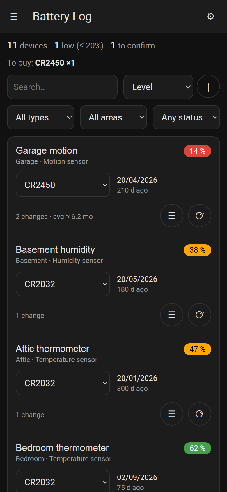
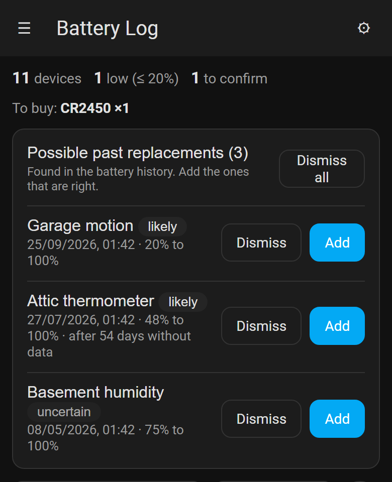

# Battery Log for Home Assistant

[Українська версія](README.uk.md)

A small, local-only Home Assistant integration that answers three questions
about every battery-powered device in your home:

- **What battery does it take?** A type you pick from a short list you control.
- **When did I last change it, and all the times before?** A full history with
  date and notes (brand, where you bought it, ...).
- **Which ones need attention?** One table with filters, sorting and a
  "what to buy" summary.

No cloud, no external database, no per-device setup. It finds your battery
devices by itself.

[](https://my.home-assistant.io/redirect/hacs_repository/?owner=alexd-3d&repository=ha-battery-log&category=integration)

<p>
  
  
  
</p>

<p>
  
  
  
</p>


<sub>Screenshots use invented demo devices and are in English. The panel and the
integration are also available in Ukrainian and follow your Home Assistant
language. From left to right: sorting by level, history with intervals, newly
found devices (no type and no entries yet), confirming a possible replacement,
the tracked and ignored devices screen.</sub>

## Features

- **Automatic discovery.** Every device that has a battery sensor
  (`device_class: battery`, a `sensor` or a `binary_sensor`) is picked up from the
  Home Assistant registries. New devices appear on their own, nothing to add
  or ignore one by one.
- **Three entities per device**, on the device's own page: `select` battery
  type, `button` "Battery changed", `sensor` "Battery last changed".
- **Full replacement history.** Every change keeps its date, type and a free
  text note. Add, edit and delete entries; each row shows how long the
  previous battery lasted.
- **A panel instead of a card.** Sortable and filterable table (type, area,
  status), search, level colours, shopping summary by battery type,
  average battery life. The numbers above the table are shortcuts: click **low**,
  **to confirm** or a type under **To buy** to filter, and click a row to open its
  replacement list. On a phone it turns into a card list with icon buttons.
- **Level history.** Click a level badge to see the battery level over time, from the
  first recorded value and at most the last 2 years (hourly points for the last 60 days,
  daily before), with your low and warning levels and the replacements marked. It uses the
  long-term statistics of Home Assistant, so it needs a sensor that has them.
- **"Replaced?" hint.** When a battery level jumps up (default 25 points), or a
  "battery low" flag clears, the row gets a badge. Tap it to confirm: the date
  is pre-filled with when the jump was seen and you can edit it, add notes, or
  answer "Not replaced". Nothing is logged without your confirmation. A hint is raised only
  for a level that was not seen in the last 14 days, so sensors that flap between a few
  values do not nag; "Not replaced" keeps that device quiet for 14 days, and a hint
  disappears by itself when the level falls back.
- **Auto-fill by model.** When you set a battery type, other devices of the same manufacturer
  and model that have none get it too, and so does a newly found device. Conflicting
  types are never guessed, a type you clear yourself stays empty, and the panel marks
  auto-filled types. Can be switched off in the options.
- **Detect past replacements (one time, you start it).** If Home Assistant has kept the battery levels,
  **Configure, Detect past replacements** finds moments when a battery was most likely
  replaced (a lasting jump back to full). Confident findings are added to the history,
  less certain ones wait in the panel with an Add button, and the first-seen date can be
  added for devices without any entry. Devices where you made entries yourself are left
  alone, nothing is overwritten, there is a preview mode, and it always ends with a report
  (see the troubleshooting table below).
- **Your own battery types.** Nine predefined (CR2032, CR2450, CR123A, CR2, AAA,
  AA, 9V, Built-in rechargeable, Other) plus "Add new type..." from the panel.
- **Tracked devices screen.** Switch off devices that should not be tracked
  (an inverter battery bank, for example). Ignoring asks for confirmation, and
  ignored devices stay in a list from where you can restore them.
- **Import from Battery Notes** (types and last replaced dates) from the integration's
  Configure menu, shown only when Battery Notes is installed.
- **Automation friendly.** Services and events (see below).
- **Local only.** Data lives in `.storage/battery_log`; the integration makes
  no network requests.
- **English and Ukrainian**, for the integration and the panel. Dates and times
  follow your device's format.

## Install

### HACS or the Marketplace (recommended)

From Home Assistant 2026.11 HACS is built in as **Settings, Marketplace**; older versions use the
HACS integration. The steps are the same, and menu names may differ a little between versions.

1. HACS or Marketplace, three dots menu, **Custom repositories**.
2. Repository `https://github.com/alexd-3d/ha-battery-log`, category
   **Integration**, **Add**. (Or use the button at the top of this page.)
3. Find **Battery Log**, **Download**.
4. Restart Home Assistant.
5. **Settings, Devices & services, Add integration, Battery Log.** There is
   nothing to fill in.

### Manual

Copy the `custom_components/battery_log` folder into your Home Assistant
`config/custom_components/` folder, restart, then add the integration as above.

Minimum **Home Assistant 2025.8** (the oldest version that has the APIs this
integration uses; not tested on older versions). Developed and tested on the
author's own installation: Home Assistant 2026.10 and 2026.11 with Zigbee2MQTT devices.
Any integration that exposes a standard battery sensor (Zigbee, Z-Wave, Matter,
Wi-Fi, ...) should work, but only Zigbee2MQTT has been checked.

## Using it

- Open **Battery Log** from the sidebar, or from
  **Settings, Devices & services, Battery Log**. The sidebar entry is optional
  (integration options).
- **Change battery** opens a dialog: date and time (now by default), type and
  notes. The same dialog edits old entries.
- Click a row (or its list icon) to open the history of replacements. Click a level
  badge to see the battery level over time. A red border on a badge means that the device
  itself reports a low battery although its level is above the low level.
- Click the numbers above the table to filter: **low**, **to confirm**, or a type under
  **To buy**. Click again to clear; the first number clears all filters.
- The "tune" icon in the header opens **Tracked devices**.
- The battery type can also be set from the device page or in automations.

### Options

Settings, Devices & services, Battery Log, **Configure**:

| Option | Default | Meaning |
|---|---|---|
| Show in sidebar | on | The panel stays reachable from the integration page when off. |
| Low level (red) | 20% | At or below: red, counted in "to buy". A device that reports low by itself while above this level keeps its colour, gets a red border and is counted too. |
| Warning level (yellow) | 50% | Above low and up to this value: yellow, higher is green. |
| Auto-fill battery type for the same model | on | Fill the type from devices of the same manufacturer and model (also for new devices). |
| Possible replacement: level rise | 25 | A rise of at least this many points raises the "Replaced?" hint. |

Changing options reloads the integration; refresh an already open panel.

## Entities

For every tracked device:

| Entity | Notes |
|---|---|
| `select` Battery type | Options come from the shared type list. |
| `button` Battery changed | Logs a change right now. Use the panel for notes or another date. |
| `sensor` Battery last changed | Timestamp. Attributes: `changes_count`, `average_lifetime_days`, `battery_type`, `last_note`, `replacement_suspected`, `recent_changes`. |

## Services

| Service | Fields |
|---|---|
| `battery_log.change` | `device_id`, optional `date`, `note`, `battery_type` |
| `battery_log.set_type` | `device_id`, `battery_type` |
| `battery_log.add_type` | `battery_type` |

## Events

- `battery_log_changed`: `device_id`, `device_name`, `changed_at`, `note`,
  `battery_type`, `source` (`button`, `panel` or `service`).
- `battery_log_replacement_suspected`: `device_id`, `device_name`,
  `from_level`, `to_level`.

Example: ask on your phone when a replacement is suspected.

```yaml
automation:
  - alias: "Battery replaced? Confirm in Battery Log"
    triggers:
      - trigger: event
        event_type: battery_log_replacement_suspected
    actions:
      - action: notify.notify
        data:
          message: >-
            {{ trigger.event.data.device_name }}: battery level jumped
            to {{ trigger.event.data.to_level }}%. Confirm the change in Battery Log.
```

## Detect past replacements: how it decides and what the report means

It reads the long-term statistics of each battery sensor (hourly) and looks for a lasting
jump: the level before (median of 48 hours) is clearly lower than after (median of 72 hours),
and the first day afterwards stays high, so one-hour blips are ignored. A rise of 30 points
or more to at least 85%, or a smaller rise that follows a week without data, is "likely" and
added automatically; a rise of 15 to 29 points on a noisy sensor is "uncertain" and waits in
the panel for you. Candidates within three days of an existing entry are dropped. It can be
used once (the menu item disappears after a real run); a preview does not count.

It never stops with an unexplained error. The result screen always shows what was checked,
added and skipped, and if something went wrong, a code with the device and the reason:

| Code | Meaning | What happens |
|---|---|---|
| BL-D01 | The recorder is not available | Nothing was checked; check that the recorder integration is set up |
| BL-D02 | Reading the statistics of one device failed | That device is skipped, the others continue |
| BL-D03 | Analysing one device failed | That device is skipped, the others continue |
| BL-D04 | Storing a result for one device failed | The other results are stored |
| BL-D05 | Saving the "done" mark failed | Results are stored, the menu item may stay |
| BL-D00 | Something unexpected | The run stops, the counts show what was done before; details in the Home Assistant log |

If you report a problem, a screenshot of the result screen is enough. Running it again is safe.

## Coming from Battery Notes

If Battery Notes is installed, **Settings, Devices & services, Battery Log,
Configure** offers **Import from Battery Notes** (the entry is not shown when
Battery Notes is not installed). It takes over, once:

- the battery **type** of each device, only where Battery Log has none yet and only
  for types that exist in your list (types that do not exist are listed in the
  result and kept in the note; add them to the list and run it again);
- the **last replaced** date of each device as one history entry with the note
  "Imported from Battery Notes". A battery quantity such as "2x" and the
  Battery Notes note are appended to that note.

Nothing is changed in Battery Notes, running the import again does not add
anything twice, and importing does not fire the `battery_log_changed` event.
Battery Notes keeps only one date per device, and it can be the day you started
tracking rather than a real replacement, so check the dates afterwards. Both
integrations can run side by side.

## How it compares

An overview of related projects as of November 2026 (versions, dates and stars re-checked on 24 November 2026). It is based only on their
public documentation, community posts and GitHub pages (releases, licence, stars),
read by the author of Battery Log, so it is not a test of the software. Projects
change quickly: please check their pages, and open an issue here if something is
wrong or out of date.

A yellow question mark means "partly, or the pages I read did not say". It does not mean "no".

 yes &nbsp;&nbsp;  partly, or not documented &nbsp;&nbsp;  no

| | **Battery Log** | [Battery Notes](https://github.com/andrew-codechimp/HA-Battery-Notes) | [Device Sentinel](https://github.com/TheThinkingHome/device_sentinel) | [BatteryBrain](https://github.com/larsbaum/battery_brain) | [Battery Status Manager](https://github.com/OleSint/ha-battery-status-manager) |
|---|---|---|---|---|---|
| **Purpose** | <sub>Battery type and replacement log</sub> | <sub>Battery type, last replaced, low and not-reported tracking</sub> | <sub>Frozen devices, battery and signal health</sub> | <sub>Learns discharge behaviour per device</sub> | <sub>Low-battery and fast-drain notifications</sub> |
| **Version (latest release)** | <sub>0.6.2</sub> | <sub>3.8.1 (3.9.0 pre-release)</sub> | <sub>0.30.5 (pre-release)</sub> | <sub>1.0.2</sub> | <sub>1.2.0</sub> |
| **Last updated (latest release)** | <sub>24 Nov 2026</sub> | <sub>30 Oct 2026 (pre-release 14 Nov)</sub> | <sub>23 Nov 2026 (pre-release)</sub> | <sub>12 Nov 2026</sub> | <sub>7 Oct 2026</sub> |
| **Finds devices on its own** | <br><sub>From the registries, no per-device step</sub> | <br><sub>Library match, then each device is added from a discovery card or manually</sub> | <br><sub>Learns devices automatically</sub> | <br><sub>Automatic</sub> | <br><sub>All battery entities, scope chosen in setup</sub> |
| **Battery type** | <br><sub>Your own list, 9 predefined</sub> | <br><sub>Community library plus manual entry</sub> | <br><sub>Not documented</sub> | <br><sub>Not documented</sub> |  |
| **Battery quantity** |  |  | <br><sub>Not documented</sub> | <br><sub>Not documented</sub> |  |
| **Last replaced date** |  |  | <br><sub>Detected, you confirm</sub> | <br><sub>Not documented</sub> |  |
| **Full replacement history** | <br><sub>Notes, edit and delete</sub> | <br><sub>Last date only</sub> | <br><sub>With an archive</sub> | <br><sub>Not documented</sub> |  |
| **Note per replacement** |  | <br><sub>One note per device</sub> | <br><sub>Not documented</sub> | <br><sub>Not documented</sub> |  |
| **Replacement detection** | <br><sub>Hint on a level jump, you confirm; date editable</sub> | <br><sub>Event on a level rise; does not set the date</sub> | <br><sub>Detects a swap, asks you to confirm</sub> | <br><sub>Not documented</sub> |  |
| **Past replacements from history** | <br><sub>One-time scan of the long-term statistics; confident findings are added, the rest wait for your decision</sub> | <br><sub>Not documented</sub> | <br><sub>Not documented</sub> | <br><sub>Not documented</sub> | <br><sub>Not documented</sub> |
| **Lifetime between replacements** | <br><sub>Per entry and average</sub> |  | <br><sub>Not documented; has remaining-life estimates</sub> | <br><sub>Not documented</sub> | <br><sub>Has a depletion forecast instead</sub> |
| **Low battery** | <br><sub>Colour in the panel and a shopping summary, global thresholds; no entity or event</sub> | <br><sub>Sensor, per-device thresholds, events, triggers</sub> |  | <br><sub>Adaptive thresholds</sub> | <br><sub>With notifications</sub> |
| **"Not reported" detection** |  |  |  |  |  |
| **Notifications built in** | <br><sub>None built in; the sensor, services and events let you build your own</sub> | <br><sub>None built in; events, triggers and actions let you build your own</sub> |  | <br><sub>Not documented</sub> |  |
| **Events, triggers, services** | <br><sub>2 events, 3 services, a timestamp sensor</sub> | <br><sub>Events, triggers, actions</sub> | <br><sub>Fail and recover events</sub> | <br><sub>Not documented</sub> | <br><sub>Not documented</sub> |
| **Predictions or learning** |  | <br><sub>Stated in its FAQ</sub> |  |  | <br><sub>Drain alerts, depletion forecast</sub> |
| **Own table with filters** | <br><sub>Panel with a phone layout</sub> | <br><sub>Integration page and your dashboards</sub> | <br><sub>Sidebar dashboard</sub> | <br><sub>Four summary sensors</sub> |  |
| **Devices without a battery sensor in HA** |  | <br><sub>Via a companion integration</sub> | <br><sub>Not documented</sub> | <br><sub>Not documented</sub> | <br><sub>Not documented</sub> |
| **Import from another project** | <br><sub>From Battery Notes</sub> | <br><sub>Not documented</sub> | <br><sub>Not documented</sub> | <br><sub>Not documented</sub> | <br><sub>Not documented</sub> |
| **Entities added per device** | <sub>3</sub> | <sub>4 to 5</sub> | <sub>Not documented</sub> | <sub>None per device</sub> | <sub>None</sub> |
| **Network use** | <sub>None</sub> | <sub>Downloads a device library</sub> | <sub>Author states none besides your notifications</sub> | <sub>Not documented</sub> | <sub>Not documented</sub> |
| **Minimum Home Assistant** | <sub>2025.8 (tested on 2026.10 and 2026.11)</sub> | <sub>2026.9</sub> | <sub>2026.5</sub> | <sub>2025.8</sub> | <sub>2023.6</sub> |
| **Distribution** | <sub>HACS custom repository</sub> | <sub>HACS default store</sub> | <sub>HACS default store</sub> | <sub>HACS custom repository</sub> | <sub>HACS custom repository</sub> |
| **License** | <sub>MIT</sub> | <sub>MIT</sub> | <sub>GPL-3.0</sub> | <sub>MIT</sub> | <sub>MIT</sub> |
| **Maturity** | <sub>New: first release in November 2026. Runs on the author's own installation (Home Assistant 2026.10 and 2026.11, Zigbee2MQTT); automated tests and CI (Hassfest, HACS validation)</sub> | <sub>1,215 GitHub stars, many releases</sub> | <sub>50 GitHub stars, pre-releases</sub> | <sub>17 GitHub stars</sub> | <sub>2 GitHub stars</sub> |

### What Battery Log does not do

- No notifications, predictions or learning. The timestamp sensor, services and
  events are there if you want to build your own alerts.
- No low-battery or not-reported entities, triggers or per-device thresholds.
- No battery library: types are the ones you pick. The only suggestion is copying a type you set to other
  devices of the same manufacturer and model in your own home.
- No battery quantity, and no devices without a battery sensor in Home Assistant.
- Tested on the author's own installation only (Home Assistant 2026.10 and 2026.11, Zigbee2MQTT devices).
  The minimum version, 2025.8, is derived from the Home Assistant APIs the integration uses and
  was not tested on older versions.
- A young project with one author.

Sources: [Battery Notes docs](https://codechimp.org/HA-Battery-Notes/) and
[FAQ](https://codechimp.org/HA-Battery-Notes/faq/),
[Device Sentinel thread](https://community.home-assistant.io/t/device-sentinel-detect-frozen-hardware-with-device-learning/1029252),
[BatteryBrain thread](https://community.home-assistant.io/t/new-integration-batterybrain-learns-your-battery-behavior/1011604),
[Battery Status Manager thread](https://community.simon42.com/t/ha-battery-status-monitor-schwellwert-und-verlustrate-aller-battery-entitaeten-monitoren/85429),
and the GitHub pages of each project.
They can be combined: Battery Log only needs a battery sensor from any integration.

## Good to know

- The panel requires an administrator account.
- Battery levels from some devices jump around (Zigbee sensors that report in
  coarse steps, often 50, 75 and 100 in turn). A "Replaced?" hint needs a level higher than
  anything seen in the last 14 days, a device is only watched for hints after its first
  3 days, and **Not replaced** silences that device for 14 days.
- A device without any battery sensor in Home Assistant is not discovered.
- Removing the integration leaves `.storage/battery_log` in place so your
  history survives a reinstall. Delete the file if you want it gone.

## Development

```bash
python -m pytest tests
node --check custom_components/battery_log/frontend/battery-log-panel.js
```

Issues and pull requests are welcome. Licensed under the [MIT License](LICENSE).
