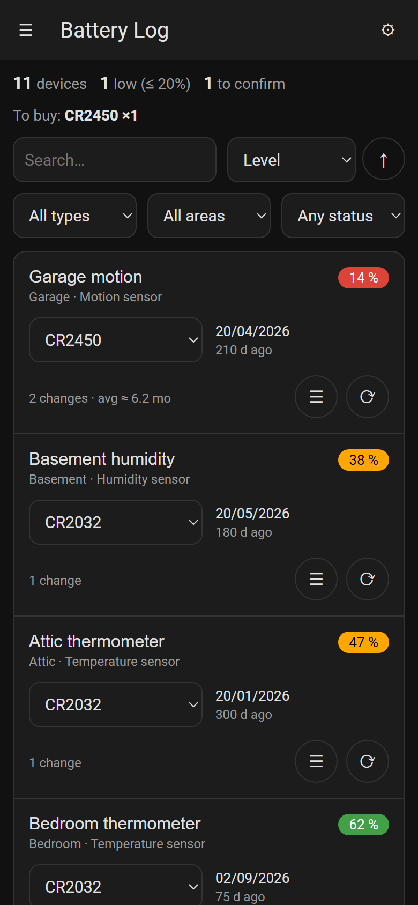
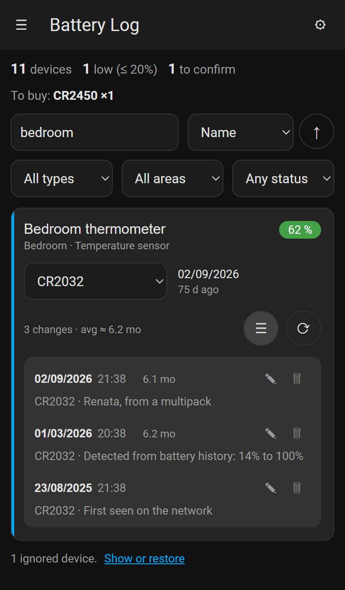
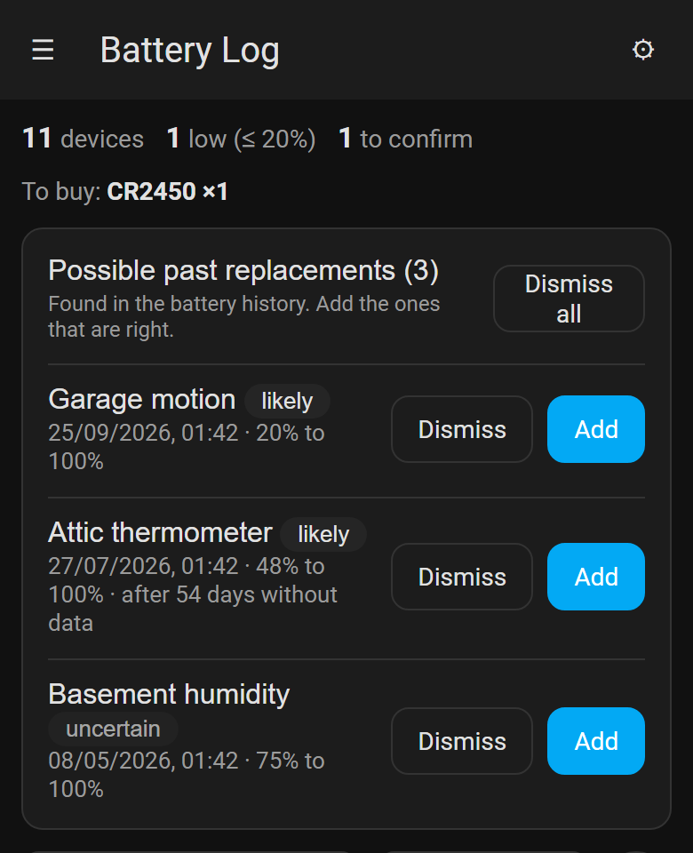
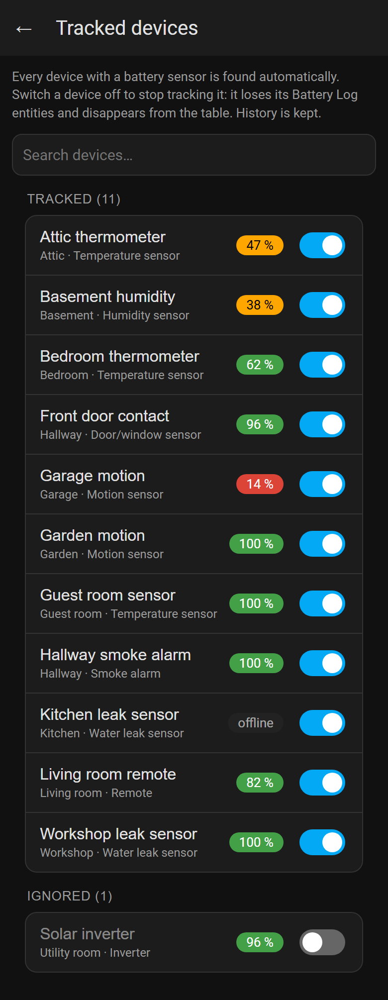

# Battery Log (Журнал батарей) для Home Assistant

[English version](README.md)

Невелика локальна інтеграція Home Assistant, яка про кожен пристрій на батарейках
відповідає на три запитання:

- **Яка в нього батарея?** Тип, який ви обираєте зі свого короткого списку.
- **Коли я її міняв і всі попередні рази?** Повна історія з датою й нотатками
  (виробник, де куплено тощо).
- **Які пристрої потребують уваги?** Одна таблиця з фільтрами, сортуванням і
  підсумком «що купити».

Без хмари, без зовнішніх баз даних, без налаштування кожного пристрою окремо.
Пристрої з батареями знаходяться самі.

[](https://my.home-assistant.io/redirect/hacs_repository/?owner=alexd-3d&repository=ha-battery-log&category=integration)

<p>
  
  
  
</p>

<p>
  
  
  
</p>


<sub>На знімках вигадані демо-пристрої, інтерфейс англійською. Українською панель і
інтеграція вмикаються за мовою вашого профілю Home Assistant. Зліва направо:
сортування за рівнем, історія з інтервалами, нові знайдені пристрої (ще без типу й
записів), підтвердження можливої заміни, екран відстежуваних і ігнорованих пристроїв.</sub>

## Можливості

- **Автоматичне виявлення.** Кожен пристрій із датчиком батареї
  (`device_class: battery`, `sensor` або `binary_sensor`) підхоплюється з реєстрів
  Home Assistant. Нові пристрої зʼявляються самі, додавати чи ігнорувати по
  одному не треба.
- **Три сутності на пристрій** на його власній сторінці: `select` тип батареї,
  `button` «Батарею замінено», `sensor` «Остання заміна батареї».
- **Повна історія замін.** Кожна заміна зберігає дату, тип і довільну нотатку.
  Записи можна додавати, змінювати й видаляти; у кожному рядку видно, скільки
  прожила попередня батарея.
- **Панель замість картки.** Таблиця з сортуванням і фільтрами (тип, зона,
  стан), пошук, кольори рівня, підсумок «купити» за типами батарей, середній
  термін служби. На телефоні вона перетворюється на список карток із кнопками-іконками.
- **Підказка «Замінено?».** Коли рівень батареї різко зростає (за замовчуванням
  на 25 пунктів) або зникає ознака «низький заряд», біля рядка зʼявляється
  позначка. Торкніться її, щоб підтвердити: дата підставляється з моменту, коли
  стрибок побачили, її можна змінити, додати нотатку або відповісти «Не
  замінювали». Без вашого підтвердження нічого не записується.
- **Автозаповнення за моделлю.** Коли ви встановлюєте тип батареї, інші пристрої того ж
  виробника й моделі без типу отримують його теж, так само й щойно знайдений пристрій.
  Суперечливі типи не вгадуються, тип, який ви очистили самі, лишається порожнім, а панель
  позначає автозаповнені типи. Можна вимкнути в параметрах.
- **Виявлення минулих замін (одноразово).** Якщо Home Assistant зберіг рівні батарей,
  **Configure, Виявити минулі заміни** знаходить моменти, коли батарею, найімовірніше,
  замінили (стійкий стрибок назад до повного заряду). Впевнені знахідки додаються в історію,
  менш певні чекають у панелі з кнопкою «Додати», а дату першої появи можна додати для
  пристроїв без записів. Пристрої, де записи зробили ви, пропускаються, нічого не
  перезаписується, є режим попереднього перегляду, і завершується це завжди звітом
  (див. таблицю помилок нижче).
- **Власні типи батарей.** Дев'ять готових (CR2032, CR2450, CR123A, CR2, AAA, AA,
  9V, Built-in rechargeable, Other) і «Додати новий тип…» просто з панелі.
- **Екран відстежуваних пристроїв.** Вимкніть пристрої, які не треба
  відстежувати (наприклад, акумулятор інвертора). Ігнорування просить
  підтвердження, а ігноровані пристрої лишаються у списку, звідки їх можна повернути.
- **Імпорт із Battery Notes** (типи й дати останньої заміни) з меню Configure
  інтеграції; зʼявляється лише коли Battery Notes встановлено.
- **Зручно для автоматизацій.** Є сервіси й події (нижче).
- **Лише локально.** Дані лежать у `.storage/battery_log`; інтеграція не робить
  жодних мережевих запитів.
- **Українська та англійська** для інтеграції та панелі. Дати й час показуються
  у форматі вашого пристрою.

## Встановлення

### HACS (рекомендовано)

1. HACS, меню з трьома крапками, **Custom repositories**.
2. Репозиторій `https://github.com/alexd-3d/ha-battery-log`, категорія
   **Integration**, **Add**. (Або скористайтеся кнопкою вгорі сторінки.)
3. Знайдіть **Battery Log** у HACS і натисніть **Download**.
4. Перезапустіть Home Assistant.
5. **Settings, Devices & services, Add integration, Battery Log.** Нічого
   заповнювати не треба.

### Вручну

Скопіюйте теку `custom_components/battery_log` у `config/custom_components/` вашого
Home Assistant, перезапустіть і додайте інтеграцію, як описано вище.

Мінімум **Home Assistant 2025.8** (найстаріша версія з потрібними інтеграції
API; на старіших не перевірялось). Розроблено й перевірено лише на інсталяції
автора: Home Assistant 2026.10 із пристроями Zigbee2MQTT. Має працювати з будь-якою
інтеграцією, яка віддає стандартний датчик батареї (Zigbee, Z-Wave, Matter, Wi-Fi
тощо), але перевірено лише Zigbee2MQTT.

## Як користуватися

- Відкрийте **Журнал батарей** у бічному меню або в
  **Settings, Devices & services, Battery Log**. Пункт у бічному меню
  необовʼязковий (параметри інтеграції).
- **Замінити батарею** відкриває діалог: дата й час (за замовчуванням зараз), тип і
  нотатки. Той самий діалог редагує старі записи.
- Іконка списку в рядку відкриває історію пристрою.
- Іконка налаштувань угорі відкриває **Відстежувані пристрої**.
- Тип батареї можна змінити й на сторінці пристрою чи в автоматизаціях.

### Параметри

Settings, Devices & services, Battery Log, **Configure**:

| Параметр | За замовчуванням | Значення |
|---|---|---|
| Показувати в бічному меню | увімкнено | Якщо вимкнено, панель лишається доступною зі сторінки інтеграції. |
| Низький рівень (червоний) | 20% | Цей рівень і нижче: червоний, враховується в «купити». |
| Рівень попередження (жовтий) | 50% | Вище «низького» і до цього значення жовтий, вище зелений. |
| Автозаповнення типу батареї за такою ж моделлю | увімкнено | Підставляти тип з пристроїв того ж виробника й моделі (також для нових пристроїв). |
| Можлива заміна: зростання рівня | 25 | Зростання щонайменше на стільки пунктів викликає підказку «Замінено?». |

Після зміни параметрів інтеграція перезавантажується; оновіть уже відкриту панель.

## Сутності

Для кожного відстежуваного пристрою:

| Сутність | Примітки |
|---|---|
| `select` Тип батареї | Варіанти беруться зі спільного списку типів. |
| `button` Батарею замінено | Записує заміну просто зараз. Для нотатки чи іншої дати використовуйте панель. |
| `sensor` Остання заміна батареї | Часова позначка. Атрибути: `changes_count`, `average_lifetime_days`, `battery_type`, `last_note`, `replacement_suspected`, `recent_changes`. |

## Сервіси

| Сервіс | Поля |
|---|---|
| `battery_log.change` | `device_id`, необовʼязково `date`, `note`, `battery_type` |
| `battery_log.set_type` | `device_id`, `battery_type` |
| `battery_log.add_type` | `battery_type` |

## Події

- `battery_log_changed`: `device_id`, `device_name`, `changed_at`, `note`,
  `battery_type`, `source` (`button`, `panel` або `service`).
- `battery_log_replacement_suspected`: `device_id`, `device_name`,
  `from_level`, `to_level`.

Приклад: надіслати повідомлення на телефон, коли підозрюється заміна.

```yaml
automation:
  - alias: "Батарею замінено? Підтвердіть у Battery Log"
    triggers:
      - trigger: event
        event_type: battery_log_replacement_suspected
    actions:
      - action: notify.notify
        data:
          message: >-
            {{ trigger.event.data.device_name }}: рівень батареї виріс
            до {{ trigger.event.data.to_level }}%. Підтвердіть заміну в Battery Log.
```

## Виявлення минулих замін: як воно вирішує і що означає звіт

Воно читає довгострокову статистику кожного датчика батареї (погодинну) і шукає стійкий
стрибок: рівень до (медіана за 48 годин) помітно нижчий за рівень після (медіана за 72
години), а перша доба після стрибка лишається високою, тож одногодинні сплески ігноруються.
Зростання на 30 пунктів і більше до щонайменше 85% або менше зростання після тижня без даних
вважається «ймовірним» і додається автоматично; зростання на 15–29 пунктів на шумному
датчику вважається «невпевненим» і чекає в панелі на ваше рішення. Кандидати ближче ніж за три
дні від наявного запису відкидаються. Це можна використати один раз (після справжнього
запуску пункт меню зникає); попередній перегляд не рахується.

Воно ніколи не зупиняється з незрозумілою помилкою. Екран результату завжди показує, що
перевірено, додано й пропущено, а якщо щось пішло не так, код із пристроєм і причиною:

| Код | Значення | Що відбувається |
|---|---|---|
| BL-D01 | Recorder недоступний | Нічого не перевірялось; перевірте, що інтеграція recorder налаштована |
| BL-D02 | Не вдалось прочитати статистику одного пристрою | Цей пристрій пропускається, інші тривають |
| BL-D03 | Не вдалось проаналізувати один пристрій | Цей пристрій пропускається, інші тривають |
| BL-D04 | Не вдалось зберегти результат одного пристрою | Інші результати збережено |
| BL-D05 | Не вдалось зберегти позначку «виконано» | Результати збережено, пункт меню може лишитись |
| BL-D00 | Щось неочікуване | Запуск зупиняється, лічильники показують, що зроблено до того; подробиці в журналі Home Assistant |

Якщо повідомляєте про проблему, достатньо скріншота екрана результату. Повторний запуск безпечний.

## Перехід із Battery Notes

Якщо Battery Notes встановлено, у **Settings, Devices & services, Battery Log,
Configure** зʼявляється пункт **Імпорт з Battery Notes** (без встановленого
Battery Notes цього пункту нема). Він одноразово переносить:

- **тип** батареї кожного пристрою, лише там, де в Battery Log його ще нема, і лише для
  типів зі списку (типи, яких нема в списку, перелічуються в результаті й
  зберігаються в нотатці; додайте їх до списку й запустіть знову);
- дату **останньої заміни** кожного пристрою як один запис в історії з нотаткою
  «Imported from Battery Notes». Кількість батарей (наприклад, «2x») і нотатка
  з Battery Notes додаються до цієї нотатки.

У Battery Notes нічого не змінюється, повторний імпорт нічого не дублює, а сам
імпорт не викликає подію `battery_log_changed`. Battery Notes тримає лише одну
дату на пристрій, і це може бути день початку відстеження, а не справжня заміна,
тож перевірте дати після імпорту. Обидві інтеграції можуть працювати поруч.

## Порівняння з іншими

Огляд схожих проєктів станом на листопад 2026. Він спирається лише на їхню
публічну документацію, дописи спільноти й сторінки GitHub (релізи, ліцензія,
зірки), які прочитав автор Battery Log, тож це не тестування програм. Проєкти
швидко змінюються: перевіряйте їхні сторінки й відкрийте issue тут, якщо щось
неправильне чи застаріле.

Жовтий знак питання означає «частково, або на прочитаних мною сторінках про це не сказано». Це не означає «ні».

 є &nbsp;&nbsp;  частково, або не описано &nbsp;&nbsp;  нема

| | **Battery Log** | [Battery Notes](https://github.com/andrew-codechimp/HA-Battery-Notes) | [Device Sentinel](https://github.com/TheThinkingHome/device_sentinel) | [BatteryBrain](https://github.com/larsbaum/battery_brain) | [Battery Status Manager](https://github.com/OleSint/ha-battery-status-manager) |
|---|---|---|---|---|---|
| **Призначення** | <sub>Тип батареї та журнал замін</sub> | <sub>Тип батареї, остання заміна, відстеження низького заряду й відсутності звітів</sub> | <sub>Завислі пристрої, стан батареї та сигналу</sub> | <sub>Вивчає розряд кожного пристрою</sub> | <sub>Сповіщення про низький заряд і швидкий розряд</sub> |
| **Версія (останній реліз)** | <sub>0.3.2</sub> | <sub>3.8.1 (3.9.0 пре-реліз)</sub> | <sub>0.29.4 (пре-реліз)</sub> | <sub>1.0.2</sub> | <sub>1.2.0</sub> |
| **Останнє оновлення (останній реліз)** | <sub>16 лис 2026</sub> | <sub>14 лис 2026</sub> | <sub>16 лис 2026</sub> | <sub>12 лис 2026</sub> | <sub>7 жов 2026</sub> |
| **Самі знаходять пристрої** | <br><sub>З реєстрів, без кроку на пристрій</sub> | <br><sub>Збіг із бібліотекою, потім кожен пристрій додається з картки виявлення чи вручну</sub> | <br><sub>Вивчає пристрої автоматично</sub> | <br><sub>Автоматично</sub> | <br><sub>Усі сутності батарей, обсяг у налаштуванні</sub> |
| **Тип батареї** | <br><sub>Ваш список, 9 готових</sub> | <br><sub>Бібліотека спільноти й ручне введення</sub> | <br><sub>Не описано</sub> | <br><sub>Не описано</sub> |  |
| **Кількість батарей** |  |  | <br><sub>Не описано</sub> | <br><sub>Не описано</sub> |  |
| **Дата останньої заміни** |  |  | <br><sub>Визначає, ви підтверджуєте</sub> | <br><sub>Не описано</sub> |  |
| **Повна історія замін** | <br><sub>Нотатки, редагування й видалення</sub> | <br><sub>Лише остання дата</sub> | <br><sub>З архівом</sub> | <br><sub>Не описано</sub> |  |
| **Нотатка до заміни** |  | <br><sub>Одна нотатка на пристрій</sub> | <br><sub>Не описано</sub> | <br><sub>Не описано</sub> |  |
| **Виявлення заміни** | <br><sub>Підказка при стрибку рівня, ви підтверджуєте; дату можна змінити</sub> | <br><sub>Подія при зростанні рівня; дату не встановлює</sub> | <br><sub>Виявляє заміну, просить підтвердити</sub> | <br><sub>Не описано</sub> |  |
| **Тривалість між замінами** | <br><sub>Для кожного запису й середня</sub> |  | <br><sub>Не описано; є оцінка залишкового терміну</sub> | <br><sub>Не описано</sub> | <br><sub>Натомість є прогноз розряду</sub> |
| **Низький заряд** | <br><sub>Колір у панелі й підсумок «купити», глобальні пороги; без сутності чи події</sub> | <br><sub>Сенсор, пороги на пристрій, події, тригери</sub> |  | <br><sub>Адаптивні пороги</sub> | <br><sub>Зі сповіщеннями</sub> |
| **Виявлення «не звітує»** |  |  |  |  |  |
| **Вбудовані сповіщення** | <br><sub>Вбудованих нема; сенсор, сервіси й події дозволяють зробити власні</sub> | <br><sub>Вбудованих нема; події, тригери й дії дозволяють зробити власні</sub> |  | <br><sub>Не описано</sub> |  |
| **Події, тригери, сервіси** | <br><sub>2 події, 3 сервіси, сенсор часу</sub> | <br><sub>Події, тригери, дії</sub> | <br><sub>Події збою й відновлення</sub> | <br><sub>Не описано</sub> | <br><sub>Не описано</sub> |
| **Прогнози чи навчання** |  | <br><sub>Сказано в його FAQ</sub> |  |  | <br><sub>Сповіщення про розряд, прогноз</sub> |
| **Власна таблиця з фільтрами** | <br><sub>Панель із розкладкою для телефона</sub> | <br><sub>Сторінка інтеграції та ваші дашборди</sub> | <br><sub>Дашборд у бічному меню</sub> | <br><sub>Чотири зведені сенсори</sub> |  |
| **Пристрої без датчика батареї в HA** |  | <br><sub>Через допоміжну інтеграцію</sub> | <br><sub>Не описано</sub> | <br><sub>Не описано</sub> | <br><sub>Не описано</sub> |
| **Імпорт з іншого проєкту** | <br><sub>З Battery Notes</sub> | <br><sub>Не описано</sub> | <br><sub>Не описано</sub> | <br><sub>Не описано</sub> | <br><sub>Не описано</sub> |
| **Сутностей на пристрій** | <sub>3</sub> | <sub>4–5</sub> | <sub>Не описано</sub> | <sub>Немає на пристрій</sub> | <sub>Немає</sub> |
| **Використання мережі** | <sub>Жодного</sub> | <sub>Завантажує бібліотеку пристроїв</sub> | <sub>Автор стверджує, що нема, окрім ваших сповіщень</sub> | <sub>Не описано</sub> | <sub>Не описано</sub> |
| **Мінімальний Home Assistant** | <sub>2025.8 (перевірено лише на 2026.10)</sub> | <sub>2026.9</sub> | <sub>2026.5</sub> | <sub>2025.8</sub> | <sub>2023.6</sub> |
| **Поширення** | <sub>Власний репозиторій HACS</sub> | <sub>Стандартний каталог HACS</sub> | <sub>Стандартний каталог HACS</sub> | <sub>Власний репозиторій HACS</sub> | <sub>Власний репозиторій HACS</sub> |
| **Ліцензія** | <sub>MIT</sub> | <sub>MIT</sub> | <sub>GPL-3.0</sub> | <sub>MIT</sub> | <sub>MIT</sub> |
| **Зрілість** | <sub>Новий: перший реліз у листопаді 2026, перевірено лише на інсталяції автора</sub> | <sub>Близько 29 000 завантажень у HACS, 1 209 зірок на GitHub, багато релізів</sub> | <sub>32 зірки на GitHub, пре-релізи</sub> | <sub>17 зірок на GitHub</sub> | <sub>2 зірки на GitHub</sub> |

### Чого Battery Log не робить

- Не надсилає сповіщень, не прогнозує й не навчається. Сенсор часу, сервіси й
  події є, якщо ви хочете зробити власні сповіщення.
- Нема сутностей, тригерів чи порогів на пристрій для низького заряду й «не звітує».
- Нема бібліотеки батарей: типи ті, що ви оберете, без автоматичної підказки за моделлю пристрою.
- Нема кількості батарей і підтримки пристроїв без датчика батареї в Home Assistant.
- Перевірено лише на інсталяції автора (Home Assistant 2026.10, пристрої Zigbee2MQTT).
  Мінімальна версія 2025.8 визначена за API Home Assistant, які використовує інтеграція,
  і на старіших версіях не перевірялась.
- Молодий проєкт з одним автором.

Джерела: [документація Battery Notes](https://codechimp.org/HA-Battery-Notes/) і
[FAQ](https://codechimp.org/HA-Battery-Notes/faq/),
[тема Device Sentinel](https://community.home-assistant.io/t/device-sentinel-detect-frozen-hardware-with-device-learning/1029252),
[тема BatteryBrain](https://community.home-assistant.io/t/new-integration-batterybrain-learns-your-battery-behavior/1011604),
[тема Battery Status Manager](https://community.simon42.com/t/ha-battery-status-monitor-schwellwert-und-verlustrate-aller-battery-entitaeten-monitoren/85429)
і сторінки GitHub кожного проєкту.
Їх можна поєднувати: Battery Log потрібен лише датчик батареї з будь-якої інтеграції.

## Варто знати

- Панель потребує облікового запису адміністратора.
- Деякі пристрої (наприклад, Zigbee-датчики з грубими кроками рівня) віддають
  рівень «стрибками». Через це можуть зʼявлятися підказки «Замінено?», які
  відхиляються кнопкою **Не замінювали**.
- Пристрій без жодного датчика батареї в Home Assistant не знаходиться.
- Видалення інтеграції лишає `.storage/battery_log` на місці, щоб історія
  пережила перевстановлення. Видаліть файл, якщо хочете позбутися даних.

## Розробка

```bash
python -m pytest tests
node --check custom_components/battery_log/frontend/battery-log-panel.js
```

Питання й пул-реквести вітаються. Ліцензія [MIT](LICENSE).
