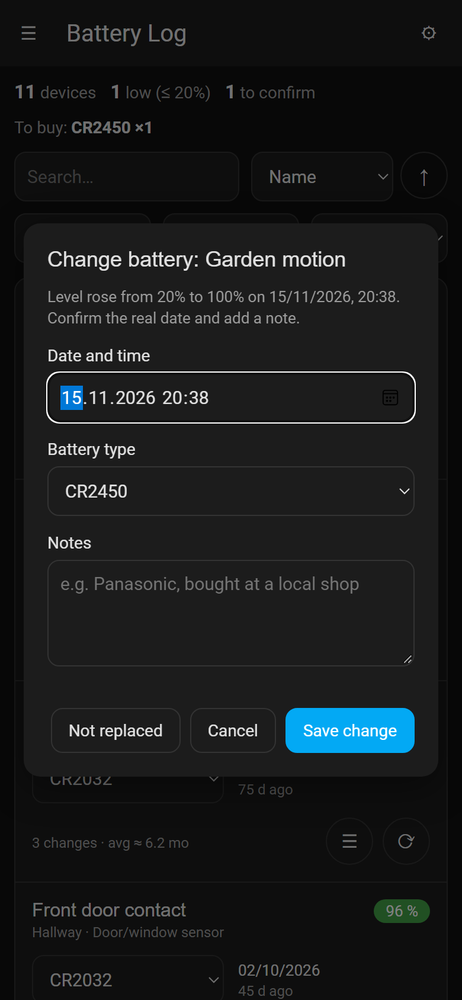

# Battery Log (Журнал батарей) для Home Assistant

[English version](README.md)

Невелика локальна інтеграція Home Assistant, яка про кожен пристрій на батарейках
відповідає на три запитання:

- **Яка в нього батарея?** Тип, який ви обираєте зі свого короткого списку.
- **Коли я її міняв і всі попередні рази?** Повна історія з датою й нотатками
  (виробник, де куплено тощо).
- **Які пристрої потребують уваги?** Одна таблиця з фільтрами, сортуванням і
  підсумком «що купити».

Без хмари, без зовнішніх баз даних, без налаштування кожного пристрою окремо.
Пристрої з батареями знаходяться самі.

[](https://my.home-assistant.io/redirect/hacs_repository/?owner=alexd-3d&repository=ha-battery-log&category=integration)

<p>
  
  
  
</p>

<p>
  
  
</p>


<sub>На знімках вигадані демо-пристрої, інтерфейс англійською. Українською панель і
інтеграція вмикаються за мовою вашого профілю Home Assistant. Зліва направо:
сортування за рівнем, історія з інтервалами, нові знайдені пристрої (ще без типу й
записів), підтвердження можливої заміни, екран відстежуваних і ігнорованих пристроїв.</sub>

## Можливості

- **Автоматичне виявлення.** Кожен пристрій із датчиком батареї
  (`device_class: battery`, `sensor` або `binary_sensor`) підхоплюється з реєстрів
  Home Assistant. Нові пристрої зʼявляються самі, додавати чи ігнорувати по
  одному не треба.
- **Три сутності на пристрій** на його власній сторінці: `select` тип батареї,
  `button` «Батарею замінено», `sensor` «Остання заміна батареї».
- **Повна історія замін.** Кожна заміна зберігає дату, тип і довільну нотатку.
  Записи можна додавати, змінювати й видаляти; у кожному рядку видно, скільки
  прожила попередня батарея.
- **Панель замість картки.** Таблиця з сортуванням і фільтрами (тип, зона,
  стан), пошук, кольори рівня, підсумок «купити» за типами батарей, середній
  термін служби. На телефоні вона перетворюється на список карток із кнопками-іконками.
- **Підказка «Замінено?».** Коли рівень батареї різко зростає (за замовчуванням
  на 25 пунктів) або зникає ознака «низький заряд», біля рядка зʼявляється
  позначка. Торкніться її, щоб підтвердити: дата підставляється з моменту, коли
  стрибок побачили, її можна змінити, додати нотатку або відповісти «Не
  замінювали». Без вашого підтвердження нічого не записується.
- **Власні типи батарей.** Дев'ять готових (CR2032, CR2450, CR123A, CR2, AAA, AA,
  9V, Built-in rechargeable, Other) і «Додати новий тип…» просто з панелі.
- **Екран відстежуваних пристроїв.** Вимкніть пристрої, які не треба
  відстежувати (наприклад, акумулятор інвертора). Ігнорування просить
  підтвердження, а ігноровані пристрої лишаються у списку, звідки їх можна повернути.
- **Зручно для автоматизацій.** Є сервіси й події (нижче).
- **Лише локально.** Дані лежать у `.storage/battery_log`; інтеграція не робить
  жодних мережевих запитів.
- **Українська та англійська** для інтеграції та панелі. Дати й час показуються
  у форматі вашого пристрою.

## Встановлення

### HACS (рекомендовано)

1. HACS, меню з трьома крапками, **Custom repositories**.
2. Репозиторій `https://github.com/alexd-3d/ha-battery-log`, категорія
   **Integration**, **Add**. (Або скористайтеся кнопкою вгорі сторінки.)
3. Знайдіть **Battery Log** у HACS і натисніть **Download**.
4. Перезапустіть Home Assistant.
5. **Settings, Devices & services, Add integration, Battery Log.** Нічого
   заповнювати не треба.

### Вручну

Скопіюйте теку `custom_components/battery_log` у `config/custom_components/` вашого
Home Assistant, перезапустіть і додайте інтеграцію, як описано вище.

Потрібен **Home Assistant 2026.10** або новіший. Розроблено й перевірено на
2026.10 із пристроями Zigbee2MQTT. Має працювати з будь-якою інтеграцією, яка
віддає стандартний датчик батареї.

## Як користуватися

- Відкрийте **Журнал батарей** у бічному меню або в
  **Settings, Devices & services, Battery Log**. Пункт у бічному меню
  необовʼязковий (параметри інтеграції).
- **Замінити батарею** відкриває діалог: дата й час (за замовчуванням зараз), тип і
  нотатки. Той самий діалог редагує старі записи.
- Іконка списку в рядку відкриває історію пристрою.
- Іконка налаштувань угорі відкриває **Відстежувані пристрої**.
- Тип батареї можна змінити й на сторінці пристрою чи в автоматизаціях.

### Параметри

Settings, Devices & services, Battery Log, **Configure**:

| Параметр | За замовчуванням | Значення |
|---|---|---|
| Показувати в бічному меню | увімкнено | Якщо вимкнено, панель лишається доступною зі сторінки інтеграції. |
| Низький рівень (червоний) | 20% | Цей рівень і нижче: червоний, враховується в «купити». |
| Рівень попередження (жовтий) | 50% | Вище «низького» і до цього значення жовтий, вище зелений. |
| Можлива заміна: зростання рівня | 25 | Зростання щонайменше на стільки пунктів викликає підказку «Замінено?». |

Після зміни параметрів інтеграція перезавантажується; оновіть уже відкриту панель.

## Сутності

Для кожного відстежуваного пристрою:

| Сутність | Примітки |
|---|---|
| `select` Тип батареї | Варіанти беруться зі спільного списку типів. |
| `button` Батарею замінено | Записує заміну просто зараз. Для нотатки чи іншої дати використовуйте панель. |
| `sensor` Остання заміна батареї | Часова позначка. Атрибути: `changes_count`, `average_lifetime_days`, `battery_type`, `last_note`, `replacement_suspected`, `recent_changes`. |

## Сервіси

| Сервіс | Поля |
|---|---|
| `battery_log.change` | `device_id`, необовʼязково `date`, `note`, `battery_type` |
| `battery_log.set_type` | `device_id`, `battery_type` |
| `battery_log.add_type` | `battery_type` |

## Події

- `battery_log_changed`: `device_id`, `device_name`, `changed_at`, `note`,
  `battery_type`, `source` (`button`, `panel` або `service`).
- `battery_log_replacement_suspected`: `device_id`, `device_name`,
  `from_level`, `to_level`.

Приклад: надіслати повідомлення на телефон, коли підозрюється заміна.

```yaml
automation:
  - alias: "Батарею замінено? Підтвердіть у Battery Log"
    triggers:
      - trigger: event
        event_type: battery_log_replacement_suspected
    actions:
      - action: notify.notify
        data:
          message: >-
            {{ trigger.event.data.device_name }}: рівень батареї виріс
            до {{ trigger.event.data.to_level }}%. Підтвердіть заміну в Battery Log.
```

## Перехід із Battery Notes

Battery Notes зберігає лише останню дату заміни, і ця дата може бути днем, коли
ви почали користуватися пристроєм, а не справжньою заміною. Щоб перенести свої
дані, викличте `battery_log.change` по одному разу для кожного пристрою
(Developer tools, Actions) із `device_id`, `date`, `battery_type` і нотаткою.
Обидві інтеграції можуть працювати поруч, тож перемикатися можна коли завгодно.

## Порівняння з іншими

Короткий фактичний огляд схожих проєктів станом на листопад 2026, за їхньою
публічною документацією та дописами спільноти. Проєкти змінюються, тож
перевіряйте актуальні деталі на їхніх сторінках і напишіть мені, якщо щось тут застаріло.

| | **Battery Log** | [Battery Notes](https://github.com/andrew-codechimp/HA-Battery-Notes) | [Device Sentinel](https://github.com/TheThinkingHome/device_sentinel) | [BatteryBrain](https://github.com/larsbaum/battery_brain) | [Battery Status Manager](https://github.com/OleSint/ha-battery-status-manager) |
|---|---|---|---|---|---|
| Головне призначення | Тип батареї та журнал замін | Тип батареї, остання заміна, відстеження низького заряду й відсутності звітів | Завислі пристрої, стан батареї та сигналу | Вивчає розряд кожного пристрою | Сповіщення про низький заряд і швидкий розряд |
| Самі знаходять пристрої з батареями | Так, з реєстрів | Збіг із бібліотекою, потім ви додаєте кожен пристрій із картки виявлення (або вручну) | Вивчає пристрої автоматично | Так | Стежить за всіма сутностями батарей (обсяг обирається під час налаштування) |
| Повна історія замін | **Так**, з нотатками, редагуванням і видаленням | Лише остання дата | Виявлення заміни, історія й архів | Не описано | Ні |
| Виявлення заміни | Підказка, ви підтверджуєте (дату можна змінити) | Подія при зростанні рівня; дату не оновлює | Виявляє заміну й просить підтвердити | Не описано | Ні |
| Інтервал між замінами | Так, для кожного запису й середній | Ні | Оцінка залишкового терміну | Не описано | Ні |
| Власна таблиця з фільтрами | Так (панель) | Ні (сторінка інтеграції та ваші дашборди) | Так (дашборд у бічному меню) | Ні (чотири зведені сенсори) | Ні |
| Тип батареї | Ваш власний список | Бібліотека спільноти й ручне введення | Не описано | Не описано | Ні |
| Сповіщення | Ні (події для ваших автоматизацій) | Ні (події, тригери, дії) | Так | Не описано | Так |
| Прогнози | Ні | Ні | Так | Адаптивні пороги | Прогноз розряду для числових сенсорів |
| Зовнішні дані | Жодних | Завантажує бібліотеку пристроїв | Не описано | Не описано | Не описано |
| Сутностей на пристрій | 3 | 4–5 | Не описано | Немає на пристрій (зведені сенсори) | Немає |

Що обрати:

- Battery Log веде **облік**: яка батарея, коли замінена, нотатки, скільки
  прослужила. Він навмисно не надсилає сповіщень і нічого не прогнозує.
- **Battery Notes**, якщо потрібна його бібліотека пристроїв і тригери
  низького заряду або відсутності звітів.
- **Device Sentinel** чи **BatteryBrain**, якщо хочете вивчений стан і прогнози;
  **Battery Status Manager**, якщо головне для вас сповіщення.
- Вони добре поєднуються: нехай інший інструмент попереджає, а заміну ви
  записуєте в Battery Log.

## Варто знати

- Панель потребує облікового запису адміністратора.
- Деякі пристрої (наприклад, Zigbee-датчики з грубими кроками рівня) віддають
  рівень «стрибками». Через це можуть зʼявлятися підказки «Замінено?», які
  відхиляються кнопкою **Не замінювали**.
- Пристрій без жодного датчика батареї в Home Assistant не знаходиться.
- Видалення інтеграції лишає `.storage/battery_log` на місці, щоб історія
  пережила перевстановлення. Видаліть файл, якщо хочете позбутися даних.

## Розробка

```bash
python -m pytest tests
node --check custom_components/battery_log/frontend/battery-log-panel.js
```

Питання й пул-реквести вітаються. Ліцензія [MIT](LICENSE).
